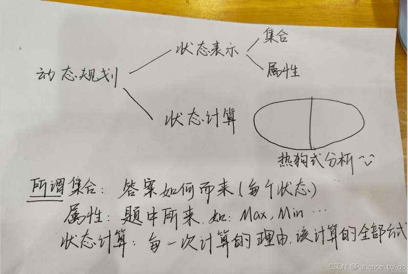
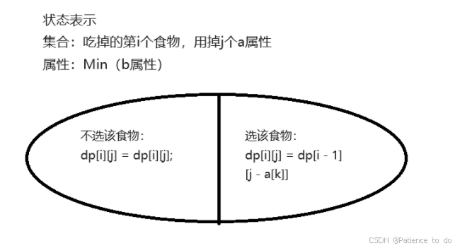
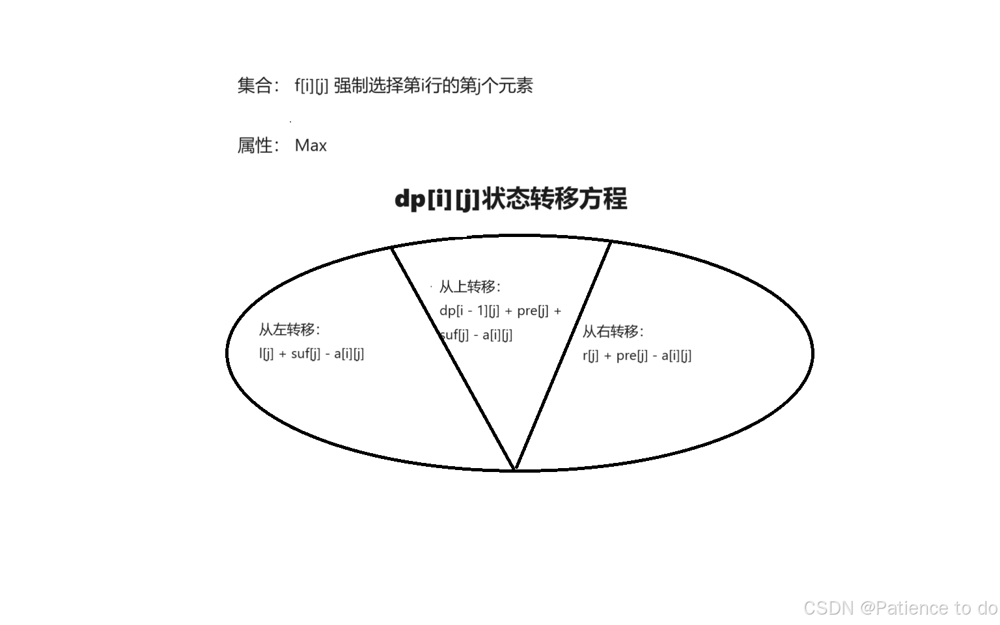
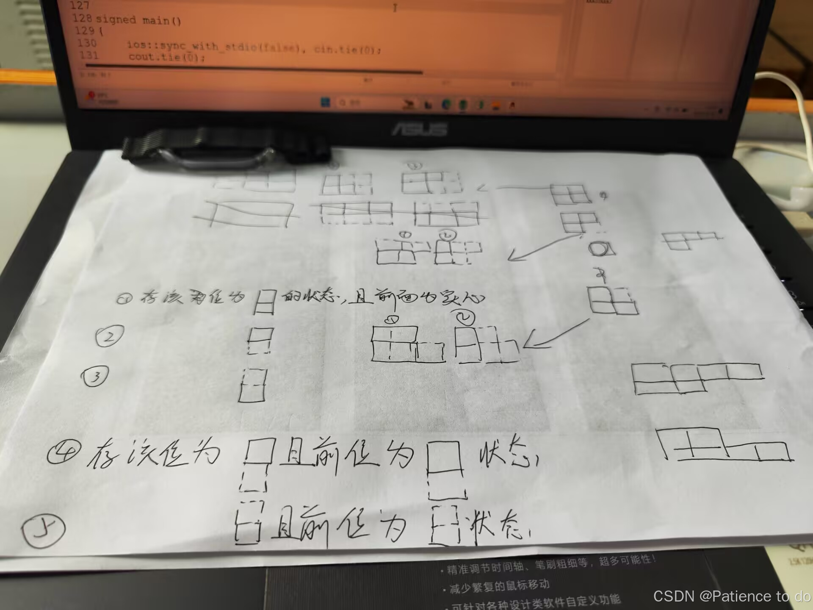

# DP手的诞生

> DP是这样的，出题人只要出题就好了，而做题的就要想很多了
>
> 喜欢和自己博弈，所以我要选DP
>
> 我有一道DP，你要不试试
>
> 又菜又爱，码垛
>
> 关注我，教我彻底学会DP

# DP题集收纳



## 背包——背不出来

###  三状态背包

> 目标状态有三，你要怎么用，用谁，转换方程怎么写

**Problem：**n个食物，每个食物有a，b两个属性，你的胃两个属性的最大值分别是x，y，问最多能糟踏多少食物（咬一口也算糟蹋了）？

**传送门**：[E - Maximum Glutton (atcoder.jp)](https://atcoder.jp/contests/abc364/tasks/abc364_e)

**Ideas：** （~~错误思路：正常来讲，我会直接把他当作一个普通的01背包，然后去贪心看看（分别用a,b属性对食物排序），果不其然wa了，后来就在想，用最小的替换掉大的，第i个物品作为二维数组变量1，a属性作为二维数组变量2，b属性作为二维数组的值1，个数作为值2，但是细想之后还是不对，因为用哪个来排序都行~~）（那就来说说==正解==：前文提到，二维数组有四个状态，但是b和个数谁来排序都不对，那么应该怎么做？前文是不是有个可有可无的变量呢？第几个物品，重要吗？好像，嗯..没用上啊那删掉，现在我总不能再拿b属性作为二维数组的变量1吧，那时间复杂度就超了，把个数当作变量1怎么样？然后只剩b数组作为值，斯，那这么说，如果个数能装到，并且使用a属性的时候让b属性尽可能小，那么，出现过的个数属性就是答案了！！！

**理论形成，转换开始：**



**Code：** 

```
#include <bits/stdc++.h>
#define int long long
#define endl "\n"

using namespace std;

const int N = 10010;

typedef long long LL;
typedef pair<int, int> PII;

int n;
int a[N], b[N];
int dp[100][N];
int x, y;

void solve() {
	cin >> n;
	cin >> x >> y;
	for(int i = 1; i <= n; i++) cin >> a[i] >> b[i];
	
	memset(dp, 0x3f, sizeof dp);
	dp[0][0] = 0;
	for(int i = 1; i <= n; i++) {
		for(int j = n; j; j--) {
			for(int k = a[i]; k <= x; k++) {
				if(dp[j - 1][k - a[i]] + b[i] <= y) dp[j][k] = min(dp[j][k], dp[j - 1][k - a[i]] + b[i]);
				
			}
		}
	}
	
	for(int i = n; i >= 0; i--) {
		for(int j = 0; j <= x; j++) {
			if(dp[i][j] <= 1e9) {
				cout << i + (i == n ? 0 : 1) << endl;
				return ;
			}
		}
	} 
}

signed main()
{
	ios::sync_with_stdio(false), cin.tie(0);
	cout.tie(0);
	
	int t = 1;
	// cin >> t;
	while(t--) {
		solve();
	}
}
```

### 10.16(1题）三角形的最大面积

**Problem：** 给定一个数组，问使用该数组构成的三角形的面积最大为多少

**传送门：**[P1284 三角形牧场 - 洛谷 | 计算机科学教育新生态 (luogu.com.cn)](https://www.luogu.com.cn/problem/P1284)

**Ideas：** 存储两条边，然后通过总边长计算即可

```
#include <bits/stdc++.h>
#define int long long
#define endl "\n"

using namespace std;

const int N = 410;

typedef long long LL;
typedef pair<int, int> PII;

int n, sum;
int a[N];
int dp[N][N]; 

void solve() {
	cin >> n;
	for(int i = 1; i <= n; i++) cin >> a[i];
	dp[0][0] = 1;
	for(int i = 1; i <= n; i++) {
		sum += a[i];
		for(int j = 400; j >= 0; j--) {
			for(int k = 400; k >= 0; k--) {
				if(j >= a[i] && dp[j - a[i]][k] == 1) dp[j][k] = 1;
				if(k >= a[i] && dp[j][k - a[i]] == 1) dp[j][k] = 1;
			}
		}
	}
	int res = 0;
	int q = sum / 2;
	for(int j = 1; j <= 400; j++) {
		for(int k = 1; k <= 400; k++) {
			if(!dp[j][k]) continue;
			res = max(res, (int)(100 * sqrt(q * (q - j) * (q - k) * (q - (sum - j - k)))));
		}
	}
	cout << res << endl;
}

signed main()
{
	ios::sync_with_stdio(false), cin.tie(0);
	cout.tie(0);
	
	int t = 1;
//	cin >> t;
	while(t--) {
		solve();
	}
}
```

### 10.16（2题）奶牛智商和情商都不可为负数的和最大值

**Problem：** n头奶牛，s,f两个值代表智商和情商，问和皆为正数的和的最大值是多少

**传送门：** [P2340 [USACO03FALL\] Cow Exhibition G - 洛谷 | 计算机科学教育新生态 (luogu.com.cn)](https://www.luogu.com.cn/problem/P2340)

**Ideas：** 存储一个智商，然后考虑到会存在负数的情况下标会越界，先给智商从大到小排序，然后进行背包即可

```
#include <bits/stdc++.h>
#define int long long
#define endl "\n"

using namespace std;

const int N = 4e6 + 10;

typedef long long LL;
typedef pair<int, int> PII;

int n;
struct P {
	int a, b;
} a[N];
int dp[N];

void solve() {
	cin >> n;
	for(int i = 1; i <= n; i++) cin >> a[i].a >> a[i].b;
	sort(a + 1, a + 1 + n, [&](const P &a, const P &b) {
		return a.a > b.a;
	});
	memset(dp, -0x3f, sizeof dp);
	
	dp[0] = 0;
	int ma = 0;
	for(int i = 1; i <= n; i++) {
		ma += abs(a[i].a);
		if(a[i].a >= 0)
			for(int j = ma; j >= 0; j--) {
				if(j >= a[i].a && j + a[i].a >= 0 && dp[j - a[i].a] >= -4000000) {
					dp[j] = max(dp[j], dp[j - a[i].a] + a[i].b);
				}
			}
		else {
			for(int j = 0; j <= ma; j++) {
				if(j >= a[i].a && j - a[i].a <= ma && dp[j - a[i].a] >= -4000000) {
					dp[j] = max(dp[j], dp[j - a[i].a] + a[i].b);
				}
			}
		}
	} 
	int res = 0;
	for(int i = 0; i < ma; i++) {
		if(dp[i] >= 0) res = max(res, i + dp[i]);
	}
	cout << res << endl;
}

signed main()
{
	ios::sync_with_stdio(false), cin.tie(0);
	cout.tie(0);
	
	int t = 1;
	// cin >> t;
	while(t--) {
		solve();
	}
}
```

### 10.16（3题） 背包之取物后问情况数量

**Problem：** n个物品，每个物品有自己的重量，你有一个背包的容量是m，问你分别把每个物品都去除后背包刚好被装满的方式有多少种？输出分别取出n个物品后该背包容量从1~m的末位。

**传送门：** [P4141 消失之物 - 洛谷 | 计算机科学教育新生态 (luogu.com.cn)](https://www.luogu.com.cn/problem/P4141)

**Ideas：** 首先把所有的物品都用上，然后分别对每个物品处理，他的转换就是通过消除这个物品的影响然后传递下去。

> 错误原因：数据溢出

```
#include <bits/stdc++.h>
#define int long long
#define endl "\n"

using namespace std;

const int N = 4010;

typedef long long LL;
typedef pair<int, int> PII;

int n, m;
int a[N];
int dp[N];

void solve() {
	cin >> n >> m;
	for(int i = 1; i <= n; i++) cin >> a[i];
	
	dp[0] = 1;
	for(int i = 1; i <= n; i++) {
		for(int j = N - 5; j >= 0; j--) {
			if(j >= a[i]) dp[j] += dp[j - a[i]];
			dp[j] %= 10;
		}
	}

	for(int i = 1; i <= n; i++) {
		int dp2[N];
		memcpy(dp2, dp, sizeof dp2);
		for(int j = 1; j <= m; j++) {
			if(j - a[i] >= 0 && dp2[j - a[i]]) dp2[j] -= dp2[j - a[i]];
			cout << (dp2[j] % 10 + 10) % 10;
		}
		cout << endl;
	}
}

signed main()
{
	ios::sync_with_stdio(false), cin.tie(0);
	cout.tie(0);
	
	int t = 1;
	// cin >> t;
	while(t--) {
		solve();
	}
}
```

### 10.18-10.20（3题）两状态背包，但只能存一个状态，另一个状态用优先队列处理

**Problem：** 有n个物品，你有m块钱，你有k次免费获得物品的机会，每个物品有两个属性，一个是价格，一个是满意度，你想要获得更多的满意度

**传送门：** [Problem - G - Codeforces](https://codeforces.com/gym/104821/problem/G)

**Ideas：** 先按照价格排序用01背包解决钱的问题，然后用优先队列存储k个物品价值大的

```
#include <bits/stdc++.h>
#define int long long
#define endl "\n"

using namespace std;

const int N = 5e3 + 10, M = 1e4 + 10;

typedef long long LL;
typedef pair<int, int> PII;

int n, m, s;
struct {
	int w, v;
} a[N];
int dp[M];

void solve() {
	cin >> n >> m >> s;
	for(int i = 1; i <= n; i++) cin >> a[i].w >> a[i].v;
	
	sort(a + 1, a + 1 + n, [&](const auto &A, const auto &B) {
		return A.w < B.w;
	});
	
	
	int res = 0;
	for(int i = 1; i <= n; i++) {
		int ans = 0;
		for(int j = m; j >= 0; j--) {
			if(j >= a[i].w) dp[j] = max(dp[j], dp[j - a[i].w] + a[i].v);
			ans = max(ans, dp[j]);
		}
		priority_queue<int> q;
		while(q.size()) q.pop();
		for(int j = i + 1; j <= n; j++) {
			q.push(a[j].v);
		}
		int k = s;
		while(k-- && q.size()) {
			ans += q.top(); q.pop();
		}
		res = max(res, ans);
		// cout << ans << endl;
	}
	cout << res << endl;
}

signed main()
{
	ios::sync_with_stdio(false), cin.tie(0);
	cout.tie(0);
	int t = 1;
	// cin >> t;
	while(t--) {
		solve();
	}
}
```

## 序列和矩阵DP优化

### 三状态转移

**Problem:** 给定一个矩阵，要求每一行都选择一个区间，并在相邻行的区间有交，最大化选中的数字和

> 碎碎念：赛时的时候想到了状态转移的方法，但是没有想清楚状态转移的方程，还是太菜了

**传送门：** [I-Intersecting Intervals_2024牛客暑期多校训练营6 (nowcoder.com)](https://ac.nowcoder.com/acm/contest/81601/I)

**Ideas：** 对于`dp[i][j]` 的定义为第i行强制选择第j个作为最大化的值，那么，不难发现，它可以从三个方向进行状态转移。上面，左边，右边。另外需要两个数组，pre表示该行以j作为结尾的最大子序列`pre[j] = max(pre[j - 1] + a[i][j], a[i][j])`，suf表示以改行以j作为开始的最大子序列` suf[j] = max(suf[j + 1] + a[i][j], a[i][j])` ，那么，从上面的转移就很清楚了，`dp[i][j] = d[i - 1][j] + pre[j] + suf[j] - a[i][j]` ，那么，左边的转移又怎么处理？用一个l数组表示该行以j结尾的最大子序列，去存储不考虑该行j~m的值，因为`suf[j]` 里面存储了右边的最大连续子序列，那么`l[j] = max(l[j - 1] + a[i][j], dp[i - 1][j] + pre[j]);` 对于`dp[i][j]` 来说的转移就是 `dp[i][j] = max(dp[i][j], l[j] + suf[j] - a[i][j]);` 右边同理。



**Code**：

```
void solve() {
	int n, m;
	cin >> n >> m;
	vector<vector<int>> a(n + 2, vector<int> (m + 2));
	vector<vector<int>> dp(n + 2, vector<int> (m + 2));
	
	for(int i = 1; i <= n; i++) {
		vector<int> pre(m + 2), suf(m + 2);
		vector<int> l(m + 2), r(m + 2);
		pre[0] = 0, suf[m + 1] = 0;
		for(int j = 1; j <= m; j++) {
			cin >> a[i][j];
		}
		for(int j = 1; j <= m; j++) {
			pre[j] = max(pre[j - 1] + a[i][j], a[i][j]);
		}
		for(int j = m; j >= 1; j--) {
			suf[j] = max(suf[j + 1] + a[i][j], a[i][j]);
		}
		l[0] = -1e18, r[m + 1] = -1e18;
		for(int j = 1; j <= m; j++) {
			l[j] = max(l[j - 1] + a[i][j], dp[i - 1][j] + pre[j]);
			dp[i][j] = l[j] + suf[j] - a[i][j];
		}
		for(int j = m; j >= 1; j--) {
			r[j] = max(r[j + 1] + a[i][j], dp[i - 1][j] + suf[j]);
			dp[i][j] = max(dp[i][j], r[j] + pre[j] - a[i][j]);
		}
	}
	
	int res = -1e18;
	for(int i = 1; i <= m; i++) {
		res = max(res, dp[n][i]);
	}
	cout << res << endl;
}
```

## 子序列转换问题

### 序列乘积个位数为6个数问题

**Problem：**对于一个数组，求有多少个子序列的fi中个位数是6的数字个数

**传送门：**[E-小红的序列乘积2.0_牛客周赛 Round 55 (nowcoder.com)](https://ac.nowcoder.com/acm/contest/87656/E)

**Ideas：** 把每一个状态记录下来，记录到第i个数中从1~9的个位数的个数记录后，通过每一次乘上a[i]获得新的状态转换，如果产生了乘积的求余为6，那么就一定会对后面的每一种情况都产生一种排列计数，那么通过快速幂进行乘法计算即可，转换过程通过for循环去依次遍历1到9，然后每一个都乘以a[i]即可

```
#include <bits/stdc++.h>
#define int long long
#define endl "\n"

using namespace std;

const int N = 2e5 + 10, mod = 1e9 + 7;

typedef pair<int, int> PII;
typedef long long LL;

int n;
int a[N];
int dp[15][2];

int qmi(int a, int k) {
	int res = 1;
	while(k) {
		if(k & 1) res = res * a % mod;
		k >>= 1;
		a = a * a % mod;
	}
	return res;
}

void solve() {
	cin >> n;
	for(int i = 1; i <= n; i++) cin >> a[i];
	
	int res = 0;
	dp[1][0] = 1;
	int last = 1, now = 0;
	for(int i = 1; i <= n; i++) {
		swap(last, now);
		for(int j = 0; j <= 9; j++) dp[j][now] = dp[j][last];
		
		for(int j = 0; j <= 9; j++) {
			dp[j * a[i] % 10][now] += dp[j][last];
			dp[j * a[i] % 10][now] %= mod;
			if(j * a[i] % 10 == 6) res += dp[j][last] * qmi(2, n - i), res %= mod;
		}
		
		// for(int j = 0; j <= 9; j++) cout << dp[j][now] << ' ';
		// cout << endl;
	}
	cout << res << endl;
}

signed main()
{
	ios::sync_with_stdio(false), cin.tie(0);
	cout.tie(0);
	
	int t = 1;
	// cin >> t;
	while(t--) {
		solve();
	}
}
```

### 10.14（1题） 子序列的a[i]&a[i - 1]!=0

**Problem：** 给定一个数组，求k的最大值，满足`a[i]&a[i - 1]!=0（2<=i<=k)` 

**传送门：**[P4310 绝世好题 - 洛谷 | 计算机科学教育新生态 (luogu.com.cn)](https://www.luogu.com.cn/problem/P4310)

**Ideas：** 按位拆分，后对每一位进行分割

```
#include <bits/stdc++.h>
#define int long long
#define endl "\n"

using namespace std;

const int N = 1e5 + 10;

typedef long long LL;
typedef pair<int, int> PII;

int n;
int a[N];
int dp[50];

void solve() {
	cin >> n;
	for(int i = 1; i <= n; i++) cin >> a[i];
	memset(dp, 0, sizeof dp);
	int x = a[1];
	int j = 0;
	while(x) {
		dp[++j] = x % 2;
		x /= 2;
	}
	
	int res = 0;
	int now = 0, last = 1;
	for(int i = 2; i <= n; i++) {
		int x = a[i];
		int dp2[50];
		memcpy(dp2, dp, sizeof dp2);
		vector<int> st; st.clear();
		
		for(int j = 1; x; j++) {
			if(x & 1) st.push_back(j);
			x /= 2;
		}
		for(auto A : st) {
			for(auto B : st) {
				dp[B] = max(dp[B], dp2[A] + 1);
			}
		}
	}
	for(int i = 1; i < 49; i++) res = max(res, dp[i]);
	cout << res << endl;
	
}

signed main()
{
	ios::sync_with_stdio(false), cin.tie(0);
	cout.tie(0);
	
	int t = 1;
//	cin >> t;
	while(t--) {
		solve();
	}
}
```

## 子串问题

### 10.14（2题）子串的匹配问题

**Problem：** (),[]匹配子串，问最长能够匹配的子串是哪个子串？

**传送门：** [P1944 最长括号匹配 - 洛谷 | 计算机科学教育新生态 (luogu.com.cn)](https://www.luogu.com.cn/problem/P1944)

**Ideas：** dp存储的是以当前位置结尾能够匹配的最大子串长度，转移来自于本身加上前面可以连贯的长度

{总结：这个题目没想到，看到题解提示了一句以当前位置结尾才顿悟了，这个思维得有}

```
#include <bits/stdc++.h>
#define int long long
#define endl "\n"

using namespace std;

const int N = 1e6 + 10;

typedef long long LL;
typedef pair<int, int> PII;

string s;
int dp[N];

void solve() {
	cin >> s;
	int n = s.size();
	s = " " + s;
	int res = 0;
	for(int i = 1; i <= n; i++) {
		if(s[i] == '(' || s[i] == '[') dp[i] = 0;
		else if(s[i] == ')') {
			if(s[i - dp[i - 1] * 2 - 1] == '(') {
				dp[i] = dp[i - 1] + 1 + dp[i - 2 - 2 * dp[i - 1]];
			}
			else {
				dp[i] = 0;
			}
		}
		else {
			if(s[i - dp[i - 1] * 2 - 1] == '[') {
				dp[i] = dp[i - 1] + 1 + dp[i - 2 - 2 * dp[i - 1]];
			}
			else {
				dp[i] = 0;
			}
		}
	}
	int mx = 1;
	for(int i = 1; i <= n; i++) {
		if(dp[mx] < dp[i]) mx = i;
//		cout << dp[i] << " ";
	}
//	cout << endl;
	for(int i = mx - 2 * dp[mx] + 1; i <= mx; i++) cout << s[i];
	cout << endl;
}

signed main()
{
	ios::sync_with_stdio(false), cin.tie(0);
	cout.tie(0);
	
	int t = 1;
//	cin >> t;
	while(t--) {
		solve();
	}
}
```

## 树形&换根

### 10.17（1题）最大子树和（换根）

**Problem：** 找到子树和的最大值，要求至少保留一根树枝，其次树枝必须通过边连着

**传送门：** [P1122 最大子树和 - 洛谷 | 计算机科学教育新生态 (luogu.com.cn)](https://www.luogu.com.cn/problem/P1122)

**Ideas：** 直接树形dp跑一边，然后另外用一个数组换根dp求一边答案就在后一个数组中，取Max即可，但要注意不能忘记必须要至少保留一根树枝

````
#include <bits/stdc++.h>
#define int long long
#define endl "\n"

using namespace std;

const int N = 16010;

typedef long long LL;
typedef pair<int, int> PII;

int n;
int a[N];
int dp[N], dp2[N];
vector<int> h[N];
int res = -1e18;

void dfs(int u, int fa) {
	dp[u] = a[u];
	for(auto A : h[u]) {
		if(A == fa) continue;
		
		dfs(A, u);
		if(dp[A] >= 0) dp[u] += dp[A];
	}
}

void dfs2(int u, int fa) {
	dp2[u] = a[u];
	for(auto A : h[u]) {
		if(A == fa) continue;
		
		dfs2(A, u);
		if(dp[A] >= 0) dp2[u] += dp[A];
	}
	res = max(res, dp2[u]);
}

void solve() {
	cin >> n;
	for(int i = 1; i <= n; i++) cin >> a[i];
	for(int i = 1; i < n; i++) {
		int x, y;
		cin >> x >> y;
		h[x].push_back(y);
		h[y].push_back(x);
	}
	
	dfs(1, 0);
	dfs2(1, 0);

	cout << res << endl;
}

signed main()
{
	ios::sync_with_stdio(false), cin.tie(0);
	cout.tie(0);
	
	int t = 1;
	// cin >> t;
	while(t--) {
		solve();
	}
}
````

### 10.17（2题）没有上司的舞会

**Problem：** 上司参加舞会，下属就不会参加，每个人都有一个快乐指数，问邀请那些职员的最大快乐指数是多少？

**传送门：** [P1352 没有上司的舞会 - 洛谷 | 计算机科学教育新生态 (luogu.com.cn)](https://www.luogu.com.cn/problem/P1352)

**Ideas：** 直接树形dp，每个点存储两个信息，一个自己不去，一个自己去，答案在树顶的两个值中的Max

```
#include <bits/stdc++.h>
#define int long long
#define endl "\n"

using namespace std;

const int N = 6e3 + 10;

typedef long long LL;
typedef pair<int, int> PII;

int n;
int a[N];
int dp[N][2];
vector<int> h[N];

void dfs(int u, int fa) {
	dp[u][0] = a[u];
	
	for(auto A : h[u]) {
		if(A == fa) continue;
		dfs(A, u);
		dp[u][0] += dp[A][1];
		dp[u][1] += max(dp[A][0], dp[A][1]);
	}
}

void solve() {
	cin >> n;
	for(int i = 1; i <= n; i++) cin >> a[i];
	for(int i = 1; i < n; i++) {
		int x, y;
		cin >> x >> y;
		h[x].push_back(y);
		h[y].push_back(x);
	}
	
	dfs(1, 0);
	cout << max(dp[1][0], dp[1][1]) << endl;
}

signed main()
{
	ios::sync_with_stdio(false), cin.tie(0);
	cout.tie(0);
	
	int t = 1;
	// cin >> t;
	while(t--) {
		solve();
	}
}
```

### 10.17（3题）一条边至少有一个点被选中

**Problem：** 一个无根树，n个节点和n-1条边，问最少选中多少个节点可以让所有的边的两端至少有一段被选中。

**传送门：** [P2016 战略游戏 - 洛谷 | 计算机科学教育新生态 (luogu.com.cn)](https://www.luogu.com.cn/problem/P2016)

**Ideas：** 两个状态，分别存储该节点被选和不被选，但要注意他的起始位置是从0开始的

```
#include <bits/stdc++.h>
#define int long long
#define endl "\n"

using namespace std;

const int N = 1510;

typedef long long LL;
typedef pair<int, int> PII;

int n;
vector<int> h[N];
int dp[N][2];

void dfs(int u, int fa) {
	dp[u][0] = 1;
	
	for(auto A : h[u]) {
		if(A == fa) continue;
		
		dfs(A, u);
		dp[u][0] += min(dp[A][0], dp[A][1]);
		dp[u][1] += dp[A][0];
	}
}

void solve() {
	cin >> n;
	for(int i = 1; i <= n; i++) {
		int x, q;
		cin >> x >> q;
		for(int j = 1; j <= q; j++) {
			int y;
			cin >> y;
			h[x].push_back(y);
			h[y].push_back(x);
		}
	}
	
	dfs(0, -1);
	cout << min(dp[0][0], dp[0][1]) << endl;
}

signed main()
{
	ios::sync_with_stdio(false), cin.tie(0);
	cout.tie(0);
	
	int t = 1;
	// cin >> t;
	while(t--) {
		solve();
	}
}
```

## 其他DP

### 10.18-10.20（1题）通过矩阵的方块求最大值

**Problem：** 给定一个2*n的矩阵，每个方块有A或J两个值，需要划分连续的三个格子，如果格子有>=2个A，则总数+1，问总数最大是多少？

**传送门：**[Problem - C - Codeforces](https://codeforces.com/contest/2022/problem/C)

**Ideas：** 本题的转换比较麻烦，我开了五个dp数组，存储不同的状态，具体见下图



```
#include <bits/stdc++.h>
#define int long long
#define endl "\n"

using namespace std;

const int N = 1e5 + 10;

typedef long long LL;
typedef pair<int, int> PII;

int n;
string a, b;
int dp1[N]; // 两
int dp2[N]; // 上
int dp3[N]; // 下
int dp4[N]; // 两个连续的上
int dp5[N]; // 两个连续的下

void solve() {
	a = b = "";
	cin >> n >> a >> b;
	a = " " + a, b = " " + b; 
	for(int i = 0; i <= n; i++) dp1[i] = dp2[i] = dp3[i] = dp4[i] = dp5[i] = 0;
	
	for(int i = 1; i <= n; i++) {
		//dp1 
		// ①
		if(i >= 3) {
			int q = 0, q2 = 0, sum = 0;
			for(int j = i - 2; j <= i; j++) {
				if(a[j] == 'A') q++;
				if(b[j] == 'A') q2++;
			}
			if(q >= 2) sum++;
			if(q2>= 2) sum++;
			dp1[i] = max(dp1[i], dp1[i - 3] + sum);
		}
		// ②
		if(i >= 3) {
			int q = 0, sum = 0;
			if(a[i - 1] == 'A') q++; 
			if(a[i] == 'A') q++;
			if(b[i] == 'A') q++;
			if(q >= 2) sum++;
			dp1[i] = max(dp1[i], dp3[i - 1] + sum);
		}
		// ③
		if(i >= 3) {
			int q = 0, sum = 0;
			if(b[i - 1] == 'A') q++; 
			if(a[i] == 'A') q++;
			if(b[i] == 'A') q++;
			if(q >= 2) sum++;
			dp1[i] = max(dp1[i], dp2[i - 1] + sum);
		}
		
		// dp2
		// ①
		if(i >= 3) {
			int q = 0, sum = 0;
			for(int j = i - 2; j <= i; j++) {
				if(a[j] == 'A') q++;
			}
			if(q >= 2) sum++;
			dp2[i] = max(dp2[i], dp5[i - 1] + sum);
		}
		
		// ②
		if(i >= 2) {
			int q = 0, sum = 0;
			if(a[i - 1] == 'A') q++; 
			if(a[i] == 'A') q++;
			if(b[i - 1] == 'A') q++;
			if(q >= 2) sum++;
			// cout << i << ' ' << q << endl;
			dp2[i] = max(dp2[i], dp1[i - 2] + sum);
		}
		
		// dp3
		// ①
		if(i >= 3) {
			int q = 0, sum = 0;
			for(int j = i - 2; j <= i; j++) {
				if(b[j] == 'A') q++;
			}
			if(q >= 2) sum++;
			dp3[i] = max(dp3[i], dp4[i - 1] + sum);
		}
		
		// ②
		if(i >= 2) {
			int q = 0, sum = 0;
			if(b[i - 1] == 'A') q++; 
			if(a[i - 1] == 'A') q++;
			if(b[i] == 'A') q++;
			if(q >= 2) sum++;
			dp3[i] = max(dp3[i], dp1[i - 2] + sum);
		}
		
		// dp4
		if(i >= 4) {
			int q = 0, sum = 0;
			for(int j = i - 2; j <= i; j++) {
				if(a[j] == 'A') q++;
			}
			if(q >= 2) sum++;
			dp4[i] = max(dp4[i], dp3[i - 2] + sum);
		}
		// dp5
		if(i >= 4) {
			int q = 0, sum = 0;
			for(int j = i - 2; j <= i; j++) {
				if(b[j] == 'A') q++;
			}
			if(q >= 2) sum++;
			dp5[i] = max(dp5[i], dp2[i - 2] + sum);
		}
	}	
	cout << dp1[n] << endl;
}

signed main()
{
	ios::sync_with_stdio(false), cin.tie(0);
	cout.tie(0);
	
	int t = 1;
	cin >> t;
	while(t--) {
		solve();
	}
}
```

### 10.18-10.20（2题）一个属性可以添加到两个属性的情况

**Problem：** 你有一些自由属性点，给你一个数组，如果是0则表示你获得了一个自由属性点，如果是>0的数，则表示力量，如果你的力量值达到则总数+1，<0的数表示智商，如果智商达到则总数+1，问你的总数最大能达到多少

**传送门：** [Problem - D - Codeforces](https://codeforces.com/contest/2025/problem/D)

**Ideas：** 开一个dp数组，对于每个0都进行转换，时间复杂度为m*m（m<5000)，存储的信息为：当前位置力量为i的情况下获得的最大收益

```
#include <bits/stdc++.h>
#define int long long
#define endl "\n"

using namespace std;

const int N = 5010, M = 2e6 + 10;

typedef long long LL;
typedef pair<int, int> PII;

int n, m;
int a[M];
int dp[N]; // 当前位置下的正数个数的最大值
int b[N], c[N]; // 正数， 负数

void solve() {
	cin >> n >> m;
	for(int i = 1; i <= n; i++) cin >> a[i];
	a[++n] = 0;
	int sum = 0;
	for(int i = 1; i <= n; i++) {
		if(a[i] == 0) {
			for(int j = 1; j <= sum; j++) b[j] += b[j - 1];
			for(int j = 1; j <= sum; j++) c[j] += c[j - 1];

			for(int j = sum; j >= 0; j--) {
				if(j >= 1) dp[j] = max(dp[j] + c[sum - j] + b[j], dp[j - 1] + b[j] + c[sum - j]);
				else dp[j] = dp[j] + c[sum - j];
			}
			
			sum++;
			for(int j = 0; j <= m + 5; j++) b[j] = c[j] = 0;
		}
		else {
			if(a[i] > 0 && a[i] <= sum) b[a[i]]++;
			if(a[i] < 0 && abs(a[i]) <= sum) c[abs(a[i])]++;
		}
	}
	
	int res = 0;
	for(int i = 0; i <= m; i++) {
		res = max(res, dp[i]);
	}
	cout << res << endl;
}

signed main()
{
	ios::sync_with_stdio(false), cin.tie(0);
	cout.tie(0);
	
	int t = 1;
	// cin >> t;
	while(t--) {
		solve();
	}
}
```

### 10.22（1题）拼接串，位运算DP

**Problem：** 给定一个长度为n的正整数串a,先可以把两个没有重叠的连续子串前后拼接起来，但要求拼接之后的数串中每个正整数都不能出现超过一次，问最大长度。

**Ideas：** 这个题目很容易陷入思维惯例，~~就会设置一个dp数组，存储当前位置的最大长度的拼接，但是不行~~，正确的做法应该是通过题目给定的18位，然后开辟数组dp长度为2^18，将其每一位的放置变成考虑到每一个数字的放法，然后通过每一个位从后循环18位，就能够获取该dp数组，然后通过一种方式去得到两个拼接串。


```
#include <bits/stdc++.h>
#define int long long
#define endl "\n"

using namespace std;

const int N = 1e6 + 10;

int n;
int a[N];
int dp[N];

void solve() {
	cin >> n;
	for(int i = 1; i <= n; i++) cin >> a[i];
	
	for(int i = 1; i <= n; i++) {
		bool st[20];
		int s = 0;
		memset(st, false, sizeof st);
		for(int j = i; j <= i + 18; j++) {
			if(st[a[j]] || j > n) break;
			st[a[j]] = true;
			s += 1 << (a[j] - 1);
			dp[s] = max(dp[s], j - i + 1);
		}
	}
	
	int res = 0;
	int q = 1 << 18;
	for(int i = 1; i <= q; i++) {
		for(int j = i; j > 0; j = i&j-1) {
			res = max(res, dp[j] + dp[i ^ j]);
		}
		
	}
	cout << res << endl;
}

signed main()
{
	ios::sync_with_stdio(false), cin.tie(0);
	cout.tie(0);
	
	
	solve();
}
```

### 10.23（1题）单调队列维护dp

**Problem：** 输入一个长度n的序列，找出一段长度不超过m的连续子序列，使得子序列中所有数的和最大。

**Ideas：** 通过维护一个单调上升的队列，存放的是位置下标，维护的是原序列的前缀和。

```
#include <cstring>
#include <iostream>
#include <algorithm>
#include <limits.h>

using namespace std;

const int N = 300010;

int n, m;
int s[N];
int q[N];

int main()
{
    scanf("%d%d", &n, &m);
    for (int i = 1; i <= n; i ++ ) scanf("%d", &s[i]), s[i] += s[i - 1];

    int res = 1e-18;
    int hh = 0, tt = 0;

    for (int i = 1; i <= n; i ++ )
    {
        if (q[hh] < i - m) hh ++ ;
        res = max(res, s[i] - s[q[hh]]);
        while (hh <= tt && s[q[tt]] >= s[i]) tt -- ;
        q[ ++ tt] = i;
    }

    printf("%d\n", res);

    return 0;
}
```

### 12.23（2题）数塔

**Problem：** 免费馅饼，你站在数轴为五的位置，每一秒可以移动一格或者原地不动，现在有n组馅饼，属性分别是a代表下落在数轴的位置，b代表下落的秒数，你不能让馅饼落地，问最多能够接多少个饼？

**Ideas：** 数塔
